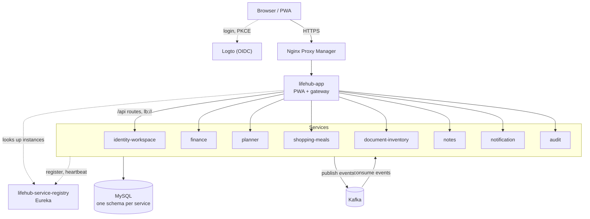
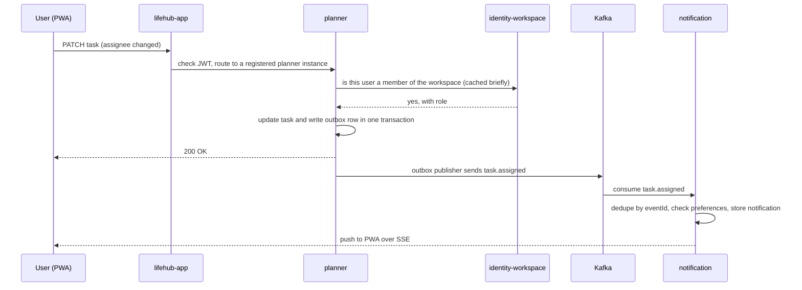

# LifeHub

A private, self-hosted personal and family management platform. One system for personal finance, shared household finance, tasks, calendar, shopping, meal planning, home inventory and documents, with individual accounts, private personal spaces and shared household spaces.

LifeHub runs as a set of Spring Boot microservices. `lifehub-app` serves the Angular PWA and is the API gateway: it checks the user's token and routes each API call to the owning service, which it finds through `lifehub-service-registry` (Eureka). Services communicate through REST at the edge and Kafka events internally. Identity is handled by an existing Logto instance, and data lives in an existing MySQL server.

> **Status:** design and planning. This document describes the intended architecture and conventions. Code samples and configuration are starting points and have not been run against a real environment yet.

---

## Table of contents

1. [Vision and principles](#1-vision-and-principles)
2. [Tech stack](#2-tech-stack)
3. [Architecture](#3-architecture)
4. [Repository structure](#4-repository-structure)
5. [Modules](#5-modules)
6. [Workspaces and permissions](#6-workspaces-and-permissions)
7. [Authentication and security](#7-authentication-and-security)
8. [Events and Kafka](#8-events-and-kafka)
9. [Notification service](#9-notification-service)
10. [Data ownership and database rules](#10-data-ownership-and-database-rules)
11. [REST API](#11-rest-api)
12. [Frontend (lifehub-web)](#12-frontend-lifehub-web)
13. [Local development](#13-local-development)
14. [Configuration](#14-configuration)
15. [Deployment with Docker Compose](#15-deployment-with-docker-compose)
16. [CI/CD with Jenkins](#16-cicd-with-jenkins)
17. [Observability](#17-observability)
18. [Testing strategy](#18-testing-strategy)
19. [Conventions](#19-conventions)
20. [Roadmap](#20-roadmap)
21. [Trade-offs, decisions and open questions](#21-trade-offs-decisions-and-open-questions)

---

## 1. Vision and principles

LifeHub should behave like one integrated product, not a collection of unrelated apps. For example:

- You record a personal expense, and separately a shared household expense.
- A family member adds an item to the shared shopping list and it shows on your dashboard.
- A household event appears on the shared calendar.
- A personal appointment stays private unless you choose to share it.

Five principles apply everywhere:

1. **Personal ownership.** Every user has a private personal workspace.
2. **Household collaboration.** Users can join one or more households, each with a shared workspace.
3. **Selective sharing.** Personal information is never shared automatically.
4. **Central authentication.** Logto identifies the person. LifeHub decides what that person may access.
5. **Mobile-first usability.** The PWA must work comfortably on phones, tablets and desktops.

### Scope of the first releases

In scope: manual entry of finances, tasks, calendar, shopping and household management, with in-app notifications first.

Explicitly out of scope for the MVP:

- Open banking and automatic bank synchronisation
- Payment processing and money transfers
- Native Android and iOS apps
- AI features (later phase)
- Complex accounting and tax calculations
- Full offline data synchronisation

---

## 2. Tech stack

| Area | Choice |
|---|---|
| Frontend | Angular, responsive PWA with a service worker |
| Backend | Java 21, Spring Boot, one service per module |
| Build | Maven multi-module build (`lifehub-parent`) |
| Edge | `lifehub-app`: the PWA plus Spring Cloud Gateway, with routes in its `application.yaml` |
| Service discovery | `lifehub-service-registry` (Eureka server); services register, `lifehub-app` routes to `lb://<service>` |
| Messaging | Apache Kafka (KRaft mode, single broker) |
| Database | Existing MySQL 8.4, one schema per service |
| Schema management | Liquibase, one changelog per service, run at startup by a migration user ([ADR 0003](deploy/docs/adr/0003-liquibase-per-service.md)) |
| Identifiers | UUIDv7, stored as `BINARY(16)` ([ADR 0004](deploy/docs/adr/0004-uuid-identifiers.md)) |
| Identity | Existing Logto, OpenID Connect, Authorization Code flow with PKCE |
| File storage | Self-hosted storage, persistent local volume initially |
| Reverse proxy | Existing Nginx Proxy Manager (TLS termination) |
| CI/CD | Existing Jenkins |
| Monitoring | Existing Uptime Kuma and Dozzle, plus metrics and tracing (see [Observability](#17-observability)) |
| Deployment | Existing Docker Compose stack |

The existing homelab stack already provides `npm` (Nginx Proxy Manager), `mysql`, `logto`, `logto-db`, `jenkins`, `uptime-kuma`, `dozzle` and `homepage`. LifeHub reuses all of them and adds only its own containers and Kafka.

---

## 3. Architecture



### How a request flows

1. The browser loads the PWA from `lifehub-app`, which serves the built Angular files.
2. The Angular app redirects to Logto, the user signs in, and Angular receives an access token using Authorization Code with PKCE.
3. Angular calls `/api/v1/...` on the same origin with the token.
4. `lifehub-app` validates the token, picks the route for the path, and looks up a live instance of the owning service in `lifehub-service-registry`.
5. `lifehub-app` forwards the request, with the token, to that instance.
6. The service validates the token again, checks workspace membership and permissions, runs the use case, and writes its own data.
7. If something notable happened, the service writes a domain event to its outbox in the same database transaction. A publisher then sends it to Kafka.
8. Other services, notably `notification` and `audit`, consume the event and react.

### Example: a task is assigned



The planner never calls the notification service directly. If notification is down, events wait in Kafka and are delivered when it returns.

---

## 4. Repository structure

A single monorepo (one repository, one Maven reactor, one Jenkins job):

```
lifehub/
├── pom.xml                  # reactor aggregator: the module list, so ./mvnw -pl <module> -am works
├── mvnw, .mvn/              # Maven wrapper (Maven 3.9.9)
├── lifehub-parent/          # parent POM: Java 21, Spring Boot 4 and Spring Cloud BOMs, every version
├── lifehub-starter/         # shared plumbing (events, outbox, security, web helpers) and every shared runtime dependency
├── lifehub-starter-test/    # every shared test library (JUnit, MockMvc, Spring Security test, Testcontainers)
│
├── lifehub-service-registry/ # Eureka server: services register here, lifehub-app looks them up
├── lifehub-web/             # Angular PWA source
├── lifehub-app/             # public entry point: the PWA plus the gateway (token check, routes)
│
├── identity-workspace/      # users, workspaces, households, invitations, roles
├── finance/                 # transactions, splits, budgets, savings goals, reports
├── planner/                 # tasks and calendar
├── shopping-meals/          # shopping lists, recipes, meal plans
├── document-inventory/      # documents, warranties, inventory, expiry dates
├── notes/                   # notes, tags, bookmarks
├── notification/            # Kafka consumer, delivery channels
├── audit/                   # append-only audit log
│
└── deploy/                  # Compose file, Kafka config, env templates, Jenkinsfile, docs
    ├── docker-compose.lifehub.yml
    ├── kafka/
    ├── env/
    ├── Jenkinsfile
    └── docs/                # architecture notes, event catalogue, ADRs
```

### Inside each service

All services share one layered layout ([ADR 0009](deploy/docs/adr/0009-layered-package-structure.md)). `identity-workspace` is the reference:

```
identity-workspace/
├── src/main/java/com/lifehub/identityworkspace/
│   ├── IdentityWorkspaceApplication.java
│   ├── config/               # this service's own Spring configuration, if any
│   ├── controller/           # REST controllers: HouseholdController, UserController, InternalMembershipController
│   ├── service/              # HouseholdService (interface) + HouseholdServiceImpl, business rules (MemberPolicy)
│   ├── repository/           # Spring Data repositories: HouseholdRepository, UserRepository
│   ├── model/
│   │   ├── entity/           # JPA entities and their enums: Household, User, WorkspaceMember
│   │   ├── dto/              # API shapes: HouseholdDTO, CreateHouseholdRequest, ChangeRoleRequest
│   │   └── event/            # event types and payloads this service publishes: IdentityEvents
│   ├── mapper/               # entity → DTO: HouseholdMapper, MemberMapper
│   ├── exception/            # service-specific exceptions, if any
│   └── util/                 # small stateless helpers: ValidationUtil, InvitationTokenUtil
├── src/main/resources/
│   ├── application.yaml      # all of this service's configuration, including JPA, Liquibase and Kafka settings
│   └── db/changelog/         # Liquibase changelog for this service's schema only
├── src/test/java/...         # same packages as main
├── Dockerfile
└── pom.xml
```

Rules:

- Controllers only translate HTTP: take the token subject and a validated DTO, call one service method, return its DTO. No repositories in controllers.
- Services are an interface plus a package-private `...Impl` annotated `@Service`. Transactions, membership checks and event publishing happen in the `Impl`.
- Entities never leave the service layer. Mappers turn them into DTOs.
- Requests are named `CreateXRequest`, `UpdateXRequest`; responses `XDTO`.
- Lombok removes boilerplate: `@RequiredArgsConstructor` for injected dependencies, `@Getter` and `@NoArgsConstructor(access = PROTECTED)` on entities, `@Slf4j` for loggers. DTOs stay Java records, and `@Data` and `@Value` are disallowed (`lombok.config`), because generated setters and equals do not suit JPA entities.
- Every method has a comment saying what it does. On entities, the comment sits on the field and Lombok's getter inherits it.
- Every service registers with `lifehub-service-registry`. Its `application.yaml` sets `spring.application.name` (the name `lifehub-app` routes to with `lb://<name>`) and this block:

  ```yaml
  eureka:
    client:
      service-url:
        defaultZone: ${EUREKA_URL:http://localhost:8761/eureka}
    instance:
      prefer-ip-address: true
  ```

  The default points at a registry on the same machine, for running locally; Compose sets `EUREKA_URL=http://lifehub-service-registry:8761/eureka`. The Eureka client itself comes from `lifehub-starter`. Tests switch it off with `eureka.client.enabled=false`.
- API docs come from `lifehub-starter` (springdoc): every service serves Swagger UI at `/swagger-ui.html`, with a `public` group (`/api/**`) and an `internal` group (`/internal/**`). `lifehub-app` serves one Swagger UI at `/swagger-ui.html` that lists every service, reading each one's public group through a `/openapi/<service>` route; the internal group is never routed. A new service adds that route and an entry under `springdoc.swagger-ui.urls` in `lifehub-app`. "Try it out" needs a Logto access token (Authorize).
- Packages appear only when they have something in them. Security, the global exception handler, the outbox and membership checks come from `lifehub-starter`, so most services have no `security/` package and only service-specific exceptions in `exception/`.

Java packages follow the module name without hyphens: `com.lifehub.identityworkspace`, `com.lifehub.shoppingmeals`, `com.lifehub.documentinventory`.

---

## 5. Modules

### Build and shared modules

| Module | Responsibility | Contains no |
|---|---|---|
| `lifehub-parent` | Parent POM. Java 21, Spring Boot BOM, managed dependency and plugin versions, the list of modules. | Code |
| `lifehub-starter` | Spring Boot starter used by every service, and the source of every dependency services share (web, security, JPA, Liquibase, MySQL driver, Kafka, Eureka client, actuator, validation). Event envelope and event types, transactional outbox and Kafka publisher, JWT validation and workspace membership checks (a client for the `identity-workspace` API with a short cache), `ProblemDetail` error handling, pagination and common DTOs. | Business logic |
| `lifehub-starter-test` | The test libraries every business service shares: `spring-boot-starter-test`, MockMvc, Spring Security test and Testcontainers for MySQL. Services add it once with `<scope>test</scope>`. | Code |

### Edge and frontend modules

| Module | Responsibility |
|---|---|
| `lifehub-service-registry` | The Eureka server. Every service and `lifehub-app` register with it on startup under their `spring.application.name` and send heartbeats; dead instances drop out within about 30 seconds. Reachable only on the Docker network. |
| `lifehub-web` | The Angular PWA source. Built with `ng build`, never deployed on its own. |
| `lifehub-app` | The public entry point and API gateway. Serves the built `lifehub-web` output, validates user tokens on `/api/**`, and routes each path to its owning service with the Spring Cloud Gateway routes in its `application.yaml` (`lb://<service>`). `/internal/**` has no route. Rate limiting is not built yet. |

The browser only ever talks to `lifehub-app`. `lifehub-app` finds services by name through `lifehub-service-registry`, so no service URL is configured anywhere ([ADR 0011](deploy/docs/adr/0011-routing-in-app-with-eureka.md)).

### What belongs in `lifehub-app`

- The `main` class and Spring Boot startup
- `application.yaml` with the route table, the Logto issuer and audience (`lifehub.security`), the registry URL, actuator and logging settings
- The token check (`config/SecurityConfig`) and serving the PWA
- Serving the Angular build and the fallback to `index.html` for client-side routes
- The Dockerfile and the Maven steps that bundle the PWA

It owns no schema, no database scripts, no repositories and no business services. If a service class or repository appears here, it belongs in another module.

### Business services

| Service | Owns | Publishes (examples) | Consumes (examples) |
|---|---|---|---|
| `identity-workspace` | Users, workspaces, households, memberships, roles, invitations | `user.created`, `household.created`, `member.invited`, `member.added`, `member.removed`, `member.role.changed` | None initially |
| `finance` | Categories, accounts, transactions, splits, budgets, savings goals, CSV export and reports | `transaction.created`, `transaction.updated`, `budget.threshold.exceeded` | None initially |
| `planner` | Tasks and calendar events, recurrence | `task.assigned`, `task.completed`, `task.overdue`, `calendar.event.created`, `calendar.event.reminder.due` | None initially |
| `shopping-meals` | Shopping lists and items, recipes, meal plans | `shopping.item.added`, `shopping.item.purchased` | None initially |
| `document-inventory` | Document metadata and files, inventory items, warranties, expiry dates | `document.uploaded`, `document.expiring`, `warranty.expiring` | None initially |
| `notes` | Notes, categories and tags, bookmarks and saved URLs, personal and shared visibility | None initially | None initially |
| `notification` | Notifications, preferences, push subscriptions, delivery attempts | None initially | Events from every service above |
| `audit` | Append-only audit log | None | Events from every service |

These are examples. The authoritative list, with payloads, is [`deploy/docs/events.md`](deploy/docs/events.md).

### Dependency rules

- Services depend only on `lifehub-starter` (and `lifehub-starter-test` for tests). **Services never import each other.**
- **All shared dependencies come from the starters.** A business service's POM lists `lifehub-starter`, `lifehub-starter-test` (test scope) and only the libraries no other service needs. A library that a second service needs moves into `lifehub-starter` (or `lifehub-starter-test`). `lifehub-app` and `lifehub-service-registry` are not servlet services and declare their own dependencies, because the starter's Spring MVC, JPA and Kafka would break them.
- Cross-service needs are met by an event or a REST call, never a shared repository or a database join.
- `lifehub-starter` stays thin. Shared business logic in the starter turns the system into a distributed monolith.
- Dropping a module such as `search` or `ai` into the build later should not require changing existing services.

---

## 6. Workspaces and permissions

LifeHub uses a workspace-based multi-tenant model. Every user receives a personal workspace. Every household receives a shared workspace. Every business record belongs to exactly one workspace.

- User A records a personal expense in workspace 1.
- User A records an electricity bill in the household workspace 2.
- User B belongs to workspace 2, so they see the electricity bill, but not User A's personal expense.

### Roles

A household's ID is the ID of its shared workspace. There is one value, used in URLs, records and events alike.

Household roles: **owner**, **admin**, **member**. A user can be an admin in one household and a member in another, so roles live in LifeHub's database (`identity-workspace`), not in Logto.

### Membership checks

`identity-workspace` is the source of truth for membership and roles. Other services ask it directly through an API call:

1. A workspace-scoped request reaches a service with the user's access token (human-to-machine). The service validates it and takes the user's identity (`sub`) from the validated token, never from the request body.
2. `lifehub-starter` calls an internal endpoint on `identity-workspace` using the service's own machine-to-machine token (see [Two kinds of token](#two-kinds-of-token)), for example `GET /internal/v1/workspaces/{workspaceId}/members?sub={logtoSubject}`. It returns the LifeHub user ID, status and role in that workspace, or says the user is not a member.
3. The service allows or denies the request based on the answer.

Design notes:

- **Internal only.** Endpoints under `/internal/**` are never routed by `lifehub-app` and are reachable only on the Docker network. They accept only machine-to-machine tokens with the required scope and reject user tokens.
- **Short cache.** The starter caches answers per workspace and user for a short time (for example 30 seconds, configurable), so a burst of requests does not become a burst of calls. A removed member can keep access for up to that time.
- **Fail closed.** Use timeouts and a circuit breaker. If `identity-workspace` cannot answer, the request is denied rather than allowed.
- **Bulk checks.** The endpoint also accepts a list of user IDs, so the finance service can validate every participant in a split in one call.
- **Trade-off.** `identity-workspace` is now on the path of every workspace request, so it must be kept healthy and fast. Services keep no copy of membership data and consume no membership events.

A non-member gets **404**, exactly as for a workspace that does not exist, so workspace IDs cannot be probed. A member whose role is too low gets **403**. If membership cannot be checked, the request gets **503** and is not served.

Two alternatives were considered and not chosen: a local membership copy per service fed by Kafka events, and memberships inside the JWT through Logto token enrichment.

### First login

On a user's first request, `identity-workspace` provisions the user record and the personal workspace, then publishes `user.created`. Other services find out about the workspace through the membership API the first time it is used.

---

## 7. Authentication and security

### Two kinds of token

LifeHub uses two kinds of access token, both issued by Logto:

| Token | Held by | Obtained through | Used for |
|---|---|---|---|
| **Human-to-machine** (user access token) | The Angular PWA, on behalf of a signed-in user | Authorization Code flow with PKCE | Browser calls through `lifehub-app` to the public API under `/api/v1/**` |
| **Machine-to-machine** (service access token) | A backend service, acting as itself | Client credentials grant, one Logto machine-to-machine application per service | Service-to-service calls to internal APIs under `/internal/**`, such as the membership lookup |

Rules for machine-to-machine tokens:

- **One Logto application per service**, each limited to the scopes it needs (least privilege).
- **A separate audience for the internal API.** A user token is not accepted on `/internal/**`, and a service token is not accepted on `/api/v1/**`.
- **Fetch and cache.** A service reads its client ID and secret from its environment, requests a token, caches it until shortly before it expires, then requests a new one. This is handled in `lifehub-starter`.
- **The token says which service is calling, not which user.** The user's identity is passed as an explicit parameter taken from the validated user token.
- Check Logto's documentation for the exact setup of API resources, scopes and machine-to-machine roles.

### Authentication flow (user)

1. The family member opens LifeHub.
2. Angular redirects the browser to Logto.
3. Logto authenticates the user.
4. Logto returns an authorisation code to Angular using PKCE.
5. Angular obtains an access token.
6. Angular sends the token with API requests.
7. The edge and each service validate the JWT issuer, signature, expiry and audience.
8. The service checks workspace membership and permissions.

Rules:

- Use the OIDC Authorization Code flow with PKCE. The Angular app is a **public client**. Never put a client secret in it.
- Do not represent household membership with Logto roles alone.
- Services validate the JWT themselves. The gateway check is the first line of defence, not the only one.
- The gateway forwards the user's token to services for user requests. Service-to-service calls use machine-to-machine tokens and never reuse the user's token. Event consumers have no user token, so events carry `actorUserId` and consumers trust only events from Kafka, not from users.

### Security checklist

- Backend enforces workspace membership on every workspace-scoped request. A user must never reach another household's data by changing a `workspaceId` in a URL.
- Services are not exposed through Nginx Proxy Manager. Only `lifehub-app` is.
- Kafka is not exposed outside the Docker network.
- The service worker never caches finance API responses, documents or tokens (see [Frontend](#12-frontend-lifehub-web)).
- Each service has its own MySQL user with access to its own schema only.
- Each service has its own Logto machine-to-machine application and secret. Internal endpoints check the token's audience and scope.
- Secrets live in environment files outside the repository. Only templates are committed.
- Audit records are written for sensitive operations, particularly finance and membership changes.
- HTTPS is required for PWA install and service workers on phones. Nginx Proxy Manager provides the certificate.

---

## 8. Events and Kafka

### Topics

| Topic | Produced by | Typical consumers |
|---|---|---|
| `identity.events` | identity-workspace | notification, audit |
| `finance.events` | finance | notification, audit |
| `task.events` | planner | notification, audit |
| `calendar.events` | planner | notification, audit |
| `shopping.events` | shopping-meals | notification, audit |
| `document.events` | document-inventory | notification, audit |
| `<topic>.dlt` | consumers | operators |

### Event envelope

Every event uses the same envelope, defined in `lifehub-starter`:

```json
{
  "eventId": "0193a4b2-7c1e-7d3a-9f00-2b6c1e4d8a10",
  "type": "task.assigned",
  "version": 1,
  "occurredAt": "2026-11-11T09:15:00Z",
  "workspaceId": "0193a4a0-1b2c-7e4f-8a00-5d6e7f809a1b",
  "actorUserId": "0193a49f-0c1d-7a2b-9c00-3e4f5a6b7c8d",
  "payload": {
    "taskId": "0193a4b2-6f00-7b1c-8d00-1a2b3c4d5e6f",
    "assigneeUserId": "0193a4a1-2c3d-7f50-9b00-6e7f8091a2b3",
    "title": "Pay electricity bill"
  }
}
```

- **Partition key:** `workspaceId` by default, or `userId` where per-user ordering matters.
- **Versioning:** `type` plus `version`. Add fields compatibly, and bump `version` for breaking changes. Consumers ignore unknown fields.
- **Serialisation:** JSON to start. Schemas can move to Avro or Protobuf later if needed.
- **IDs and money:** IDs are UUID strings. Amounts in events are string decimals with a currency (`"amount": "120.00"`), never JSON numbers.

### Reliable publishing: transactional outbox

A service must never commit a database change and then fail to publish its event, or the reverse. Each producer writes the event to an `outbox` table in the same transaction as the business change. A publisher in `lifehub-starter` reads unsent rows and sends them to Kafka, marking them sent on acknowledgement. Delivery is **at least once**.

### Reliable consuming: idempotency

Because delivery is at least once, consumers must tolerate duplicates:

- Keep a `processed_events` table keyed by `eventId`, and skip events already handled.
- Retry in place with backoff, then park failures on `<topic>.dlt` for inspection.

### Event catalogue

[`deploy/docs/events.md`](deploy/docs/events.md) is the single source of truth: topic, `type`, `version`, producer, consumers and payload fields for every event. An event not listed there must not be published.

---

## 9. Notification service

The notification service is the first consumer of the event stream and the main reason Kafka is in the system.

### Responsibilities

1. Consume domain events from the topics above.
2. Work out who should be told, for example the assignee of a task or the members of a household.
3. Check each recipient's preferences.
4. Store the in-app notification.
5. Deliver over the enabled channels.
6. Retry failed deliveries.

Time-based conditions (overdue tasks, calendar reminders, document and warranty expiry) are detected by the service that owns the data, which publishes an event such as `task.overdue`. Notification has no business scheduler of its own ([ADR 0008](deploy/docs/adr/0008-time-based-events-from-owning-service.md)).

### Channels

| Channel | Phase | Notes |
|---|---|---|
| In-app | 1 | Stored notifications plus live push to the PWA over SSE or WebSocket |
| Email | 2 | SMTP |
| Browser push | 4 | Web Push, with stored push subscriptions |

SSE streams pass through `lifehub-app`, which is Spring Cloud Gateway (WebFlux) and streams responses rather than buffering them.

### Notification types

Task assignments, calendar reminders, household invitations, shopping list updates, document expiry, budget alerts.

### How recipients are found

Notification keeps its own copy of workspaces, memberships, names and emails (`directory_*` tables), built from `identity.events`. It never calls identity-workspace to work out who to tell, and it only ever notifies active members of the event's workspace, apart from invitations and removals. On first start it reads every topic from the oldest retained event, so the copy is complete as long as Kafka still holds identity events (14 days).

Shopping updates for the same list are merged into one notification for 10 minutes. Email is opt-in per notification type and off until `EMAIL_ENABLED=true`; failed emails are retried with backoff. The live stream (`/stream`) needs the bearer token in the `Authorization` header, so the PWA uses a fetch-based server-sent events client rather than `EventSource`.

### Own data

`notifications`, `notification_preferences`, `push_subscriptions`, `delivery_attempts`, `processed_events`, all in the notification schema.

### API

| Method | Endpoint | Purpose |
|---|---|---|
| GET | `/api/v1/me/notifications` | List notifications |
| PATCH | `/api/v1/me/notifications/{id}` | Mark read |
| GET | `/api/v1/me/notification-preferences` | Read preferences |
| PUT | `/api/v1/me/notification-preferences` | Update preferences |
| GET | `/api/v1/me/notifications/stream` | Live stream (SSE) |

---

## 10. Data ownership and database rules

One MySQL server, one **schema per service**, one database user per schema, and schema changes managed per service.

| Service | Schema | Main tables |
|---|---|---|
| identity-workspace | `lifehub_identity` | `users`, `workspaces`, `households`, `workspace_members`, `household_invitations` |
| finance | `lifehub_finance` | `categories`, `financial_accounts`, `transactions`, `transaction_splits`, `budgets`, `savings_goals` |
| planner | `lifehub_planner` | `tasks`, `calendar_events` |
| shopping-meals | `lifehub_shopping` | `shopping_lists`, `shopping_items`, `recipes`, `meal_plans` |
| document-inventory | `lifehub_documents` | `documents`, `inventory_items` |
| notes | `lifehub_notes` | `notes`, `tags`, `bookmarks` |
| notification | `lifehub_notification` | `notifications`, `notification_preferences`, `push_subscriptions`, `delivery_attempts`, `processed_events` |
| audit | `lifehub_audit` | `audit_logs` |

Every service also has an `outbox` table, and consumers have `processed_events`.

### Rules

1. **No cross-service joins or foreign keys.** Cross-service references are plain IDs. For example `transaction_splits.user_id` is a plain value validated through the `identity-workspace` membership API.
2. Every business record carries a `workspace_id`.
3. Every workspace request validates the authenticated user's membership.
4. Amounts use `DECIMAL`, never floating point.
5. Timestamps are stored in UTC and shown in the user's timezone.
6. Soft deletion for important records where recovery matters.
7. Files are stored on disk (or object storage), never as database BLOBs.
8. Audit records for sensitive operations.
9. For shared expenses, the splits must add up to the expense amount. The finance service enforces this inside the transaction.
10. Primary keys and cross-service references are UUIDv7 stored as `BINARY(16)`, generated in the application before insert.
11. Schema changes are Liquibase changesets in the owning service, applied by its migration user. Hibernate only validates (`ddl-auto=validate`).

### Shared finance example

| Transaction | Owner | Amount | Visibility |
|---|---|---|---|
| Personal groceries | User A | £45 | Private |
| Household electricity | User A | £120 | Shared |
| Personal transport | User B | £65 | Private |
| Internet subscription | User B | £35 | Shared |

Personal and household balances are never combined automatically. They are different financial contexts.

---

## 11. REST API

All endpoints are versioned under `/api/v1/`. Workspace-specific operations put the workspace ID in the URL, so the active workspace is explicit and membership can be validated before any data is returned.

```
/api/v1/workspaces/{workspaceId}/transactions
```

### Gateway routing

Routes live in `lifehub-app/src/main/resources/application.yaml`. Each route's URI is `lb://<service>`, resolved through `lifehub-service-registry`. A service with no live instance answers 503.

| Path prefix | Routed to |
|---|---|
| `/api/v1/me/notifications**`, `/api/v1/me/notification-preferences` | notification |
| `/api/v1/me**`, `/api/v1/households**`, `/api/v1/invitations**` | identity-workspace |
| `/api/v1/workspaces/*/transactions**`, `budgets**`, `savings-goals**`, `finance/**` | finance |
| `/api/v1/workspaces/*/tasks**`, `events**` | planner |
| `/api/v1/workspaces/*/shopping-lists**`, `/api/v1/shopping-**`, `meals**`, `recipes**` | shopping-meals |
| `/api/v1/workspaces/*/documents**`, `inventory**`, `/api/v1/documents/**` | document-inventory |
| `/api/v1/workspaces/*/notes**`, `tags**`, `bookmarks**` | notes |
| `/api/v1/workspaces/*/audit**` | audit (admins only) |
| `/internal/**` | never routed (service-to-service only) |
| everything else | static PWA files, with fallback to `index.html` |

Route order matters: the more specific `/me/notifications` route has a lower `order` than the general `/me` route. `GatewayRoutesTest` checks the whole table.

### Profile and households (identity-workspace)

| Method | Endpoint | Purpose |
|---|---|---|
| GET | `/api/v1/me` | Current user profile |
| PATCH | `/api/v1/me` | Update profile |
| GET | `/api/v1/me/workspaces` | List accessible workspaces |
| POST | `/api/v1/households` | Create household |
| GET | `/api/v1/households/{id}` | Household details |
| PATCH | `/api/v1/households/{id}` | Update household |
| POST | `/api/v1/households/{id}/invitations` | Invite member |
| POST | `/api/v1/invitations/{token}/accept` | Accept invitation |
| GET | `/api/v1/households/{id}/members` | List members |
| PATCH | `/api/v1/households/{id}/members/{userId}` | Change member role |
| DELETE | `/api/v1/households/{id}/members/{userId}` | Remove member |

### Finance

| Method | Endpoint | Purpose |
|---|---|---|
| GET | `/api/v1/workspaces/{id}/transactions` | List transactions |
| POST | `/api/v1/workspaces/{id}/transactions` | Create transaction |
| GET | `/api/v1/workspaces/{id}/transactions/{transactionId}` | Transaction details |
| PATCH | `/api/v1/workspaces/{id}/transactions/{transactionId}` | Update transaction |
| DELETE | `/api/v1/workspaces/{id}/transactions/{transactionId}` | Delete transaction |
| GET | `/api/v1/workspaces/{id}/finance/summary` | Financial summary |
| GET | `/api/v1/workspaces/{id}/budgets` | List budgets |
| POST | `/api/v1/workspaces/{id}/budgets` | Create budget |
| GET | `/api/v1/workspaces/{id}/savings-goals` | Savings goals |

Example request:

```json
{
  "description": "Electricity bill",
  "amount": 120.00,
  "currency": "GBP",
  "type": "EXPENSE",
  "categoryId": "0193a4a5-3d4e-7a61-8c00-7f8091a2b3c4",
  "occurredAt": "2026-11-09T10:00:00Z",
  "splits": [
    { "userId": "0193a49f-0c1d-7a2b-9c00-3e4f5a6b7c8d", "amount": 60.00 },
    { "userId": "0193a4a1-2c3d-7f50-9b00-6e7f8091a2b3", "amount": 60.00 }
  ]
}
```

The service validates that the payer and every split participant are members of the household workspace, and that the splits sum to `amount`.

### Planner

| Method | Endpoint | Purpose |
|---|---|---|
| GET | `/api/v1/workspaces/{id}/tasks` | List tasks |
| POST | `/api/v1/workspaces/{id}/tasks` | Create task |
| PATCH | `/api/v1/workspaces/{id}/tasks/{taskId}` | Update task |
| GET | `/api/v1/workspaces/{id}/events` | List events |
| POST | `/api/v1/workspaces/{id}/events` | Create event |
| PATCH | `/api/v1/workspaces/{id}/events/{eventId}` | Update event |

### Shopping and meals

| Method | Endpoint | Purpose |
|---|---|---|
| GET | `/api/v1/workspaces/{id}/shopping-lists` | List shopping lists |
| POST | `/api/v1/workspaces/{id}/shopping-lists` | Create list |
| POST | `/api/v1/shopping-lists/{id}/items` | Add item |
| PATCH | `/api/v1/shopping-items/{itemId}` | Update item |
| DELETE | `/api/v1/shopping-items/{itemId}` | Remove item |

### Documents and inventory

| Method | Endpoint | Purpose |
|---|---|---|
| GET | `/api/v1/workspaces/{id}/documents` | List documents |
| POST | `/api/v1/workspaces/{id}/documents` | Upload document |
| GET | `/api/v1/documents/{documentId}/download` | Download document |
| DELETE | `/api/v1/documents/{documentId}` | Delete document |
| GET | `/api/v1/workspaces/{id}/inventory` | List assets |
| POST | `/api/v1/workspaces/{id}/inventory` | Register asset |

> **Note:** a few endpoints (shopping items, document download) carry the resource ID instead of the workspace ID. For these, the service must look up the resource's workspace and then check membership. Consider moving them under `/workspaces/{id}/...` so the convention is uniform.

### API conventions

- DTOs only, never JPA entities in responses.
- Bean Validation on every request.
- Pagination on every list endpoint.
- Errors use Spring's `ProblemDetail` (RFC 9457 format).
- Non-members get 404, members without the needed role get 403 (see [Membership checks](#membership-checks)).
- `@Transactional` for any operation touching several records.
- Workspace membership enforced in the backend, never trusted from the client.
- Audit logs for financial and administrative changes.

---

## 12. Frontend (lifehub-web)

Angular, feature-based structure:

```
lifehub-web/
├── src/
│   ├── app/
│   │   ├── core/        # auth, guards, interceptors, services, layout
│   │   ├── shared/      # components, pipes, directives
│   │   ├── features/    # dashboard, household, finance, calendar, tasks,
│   │   │                # shopping, documents, inventory, notes, settings
│   │   └── app.routes.ts
│   ├── assets/
│   └── manifest.webmanifest
└── package.json
```

### PWA requirements

- Install to Android, iPhone and desktop
- Responsive navigation: sidebar on desktop, bottom navigation bar and drawer on mobile
- App icons and splash screen
- Update notifications when a new version is available
- Basic offline application shell
- Browser push in a later phase

### Service worker rule

Cache **static application resources only**. Never cache finance API responses, documents or authentication tokens.

### Serving through lifehub-app

- `lifehub-app` serves the Angular build at `/` and sends unknown non-API paths to `index.html`, so refreshing on `/finance` does not return a 404.
- Because the browser sees one origin, CORS is not needed and the OIDC redirect URI stays simple.
- The Angular HTTP interceptor attaches the access token to `/api/**` calls only.

---

## 13. Local development

### Prerequisites

- Java 21
- Maven (or the wrapper in the repository)
- Node.js (the version in `lifehub-web/.nvmrc` once created) and npm
- Docker and Docker Compose (also needed to run the Testcontainers integration tests; without Docker they are skipped)
- Access to a Logto instance and a MySQL server, or local equivalents

### Build order

`lifehub-parent` → `lifehub-starter` → services and `lifehub-service-registry` → `lifehub-web` → `lifehub-app`

`lifehub-app` must build last because it bundles the Angular output. The Node step runs inside Maven through the `frontend-maven-plugin`.

### Commands (starting point)

```bash
# Build everything
./mvnw clean package

# Build one service and what it depends on
./mvnw -pl finance -am package

# Build the runnable jar including the PWA
./mvnw -pl lifehub-app -am package

# Start Kafka and dependencies for local work
docker compose -f deploy/docker-compose.lifehub.yml up -d kafka

# Run one service from the IDE or the command line
./mvnw -pl planner spring-boot:run

# Frontend with live reload (proxy /api to a running lifehub-app)
cd lifehub-web && npm install && npm start
```

### Memory budget

Each Spring Boot service is its own JVM, and Kafka needs roughly 1 GB. Eight services, `lifehub-service-registry` and `lifehub-app` (ten JVMs) plus Kafka on one host is significant. Set explicit heap limits (for example `-Xmx256m` per service and tune upwards) and run only the services you are working on during development.

---

## 14. Configuration

Configuration is supplied by environment variables and per-service `application.yml`. The variable names below are proposals.

| Variable | Used by | Purpose |
|---|---|---|
| `LOGTO_ISSUER` | all services, app | OIDC issuer URL for JWT validation |
| `LOGTO_AUDIENCE` | all services, app | Expected audience for user tokens (public API) |
| `LOGTO_CA_CERT` | all services, app | PEM of the private CA (for example mkcert) behind Logto's TLS certificate. Calls to Logto then trust only that CA. Empty for a public certificate |
| `LOGTO_INTERNAL_AUDIENCE` | identity-workspace and every service that calls it | Audience for machine-to-machine tokens (internal API) |
| `LOGTO_M2M_CLIENT_ID`, `LOGTO_M2M_CLIENT_SECRET` | each service | That service's own machine-to-machine credentials |
| `MYSQL_HOST`, `MYSQL_PORT` | all services | Database server |
| `DB_USER`, `DB_PASSWORD` | each service | That service's runtime database credentials (DML only) |
| `DB_MIGRATION_USER`, `DB_MIGRATION_PASSWORD` | each service | Credentials Liquibase uses for schema changes (DDL on that schema only) |
| `KAFKA_BOOTSTRAP_SERVERS` | all services | The Kafka listener for containers, for example `kafka:29092`; `localhost:9092` by default for local runs |
| `SMTP_HOST`, `SMTP_PORT`, `SMTP_USER`, `SMTP_PASSWORD` | notification | Email delivery |
| `EMAIL_ENABLED`, `MAIL_FROM` | notification | Turns email delivery on (off by default) and sets the sender |
| `LIFEHUB_URL` | notification | Public LifeHub URL, for links in emails |
| `IDENTITY_WORKSPACE_URL` | every service except identity-workspace | identity-workspace on the Docker network, for membership checks. Default `http://localhost:8080` |
| `SERVER_PORT` | all services, app, registry | The HTTP port. Local defaults: registry 8761, identity-workspace 8080, notification 8082, finance 8083, planner 8084, shopping-meals 8085, audit 8086, lifehub-app 8089 |
| `STORAGE_PATH` | document-inventory | Directory for uploaded files |
| `EUREKA_URL` | all services, app | The registry. Default `http://localhost:8761/eureka`; in Compose `http://lifehub-service-registry:8761/eureka` |
| `SPRINGDOC_API_DOCS_ENABLED`, `SPRINGDOC_SWAGGER_UI_ENABLED` | all services, app | Set to `false` to turn off the OpenAPI docs and Swagger UI (on by default) |

Rules:

- Commit templates only (`deploy/env/*.env.example`). Real `.env` files stay on the server.
- Never use one shared database user for all services.
- Logto settings for the Angular app: a public (SPA) application using PKCE, with the public LifeHub URL as redirect URI and post-logout redirect URI.
- Logto settings for services: one machine-to-machine application per service, with access to the internal API resource and only the scopes it needs.

---

## 15. Deployment with Docker Compose

LifeHub joins the existing homelab stack. It adds one container per module plus Kafka, and reuses `mysql`, `logto`, `npm` and the rest.

### Containers added

| Container | Exposed to | Notes |
|---|---|---|
| `lifehub-app` | Nginx Proxy Manager | The only LifeHub container with a proxy host |
| `lifehub-service-registry` | Docker network only | Port 8761. Start it first: services and `lifehub-app` need it to find each other |
| `identity-workspace`, `finance`, `planner`, `shopping-meals`, `document-inventory`, `notes`, `notification`, `audit` | Docker network only | Not published on host ports |
| `kafka` | Docker network only | KRaft mode, single broker |

### Compose sketch

The working file is [`deploy/docker-compose.lifehub.yml`](deploy/docker-compose.lifehub.yml). It reuses the homelab's existing `mysql`, `kafka` and `logto` containers on the shared network (`HOMELAB_NETWORK`, default `homelab`), gives every container a health check (bash over `/dev/tcp`, because the JRE image has no curl), and mounts Logto's private CA from `deploy/certs/`. Its header lists the steps before the first start. The sketch below shows the shape.

```yaml
services:
  kafka:
    image: apache/kafka:3.9.0          # pin the version you verify
    restart: unless-stopped
    environment:
      KAFKA_NODE_ID: 1
      KAFKA_PROCESS_ROLES: broker,controller
      KAFKA_LISTENERS: PLAINTEXT://:9092,CONTROLLER://:9093
      KAFKA_ADVERTISED_LISTENERS: PLAINTEXT://kafka:9092
      KAFKA_CONTROLLER_LISTENER_NAMES: CONTROLLER
      KAFKA_LISTENER_SECURITY_PROTOCOL_MAP: CONTROLLER:PLAINTEXT,PLAINTEXT:PLAINTEXT
      KAFKA_CONTROLLER_QUORUM_VOTERS: 1@kafka:9093
      KAFKA_OFFSETS_TOPIC_REPLICATION_FACTOR: 1
      KAFKA_TRANSACTION_STATE_LOG_REPLICATION_FACTOR: 1
      KAFKA_TRANSACTION_STATE_LOG_MIN_ISR: 1
      KAFKA_GROUP_INITIAL_REBALANCE_DELAY_MS: 0
      KAFKA_HEAP_OPTS: "-Xms512m -Xmx512m"
    volumes:
      - kafka-data:/var/lib/kafka/data
    networks: [homelab]

  planner:
    image: lifehub/planner:${LIFEHUB_VERSION}
    restart: unless-stopped
    env_file: ./env/planner.env
    depends_on: [kafka, lifehub-service-registry]
    networks: [homelab]

  lifehub-service-registry:
    image: lifehub/lifehub-service-registry:${LIFEHUB_VERSION}
    restart: unless-stopped
    networks: [homelab]

  lifehub-app:
    image: lifehub/lifehub-app:${LIFEHUB_VERSION}
    restart: unless-stopped
    env_file: ./env/lifehub-app.env
    depends_on: [lifehub-service-registry, planner]   # add the other services
    networks: [homelab]

volumes:
  kafka-data:

networks:
  homelab:
    external: true
```

Repeat the `planner` block for each service, each with its own env file.

### Nginx Proxy Manager

- One proxy host, for example `lifehub.example.com`, forwarding to `lifehub-app` on its container port.
- Enable HTTPS with a valid certificate (required for PWA install).
- Enable WebSocket support, and make sure buffering is off for the SSE stream path.

### Startup and topics

- Create topics at deploy time with [`deploy/kafka/create-topics.sh`](deploy/kafka/create-topics.sh), not by relying on auto-creation, so partitions and retention are explicit.
- Create the schemas and per-service users with [`deploy/mysql/create-schemas.sh`](deploy/mysql/create-schemas.sh). It reads the names and passwords from each `deploy/env/<service>.env`. The audit runtime user gets `SELECT` and `INSERT` only, so the audit log stays append-only.
- Each service applies its own Liquibase changelog against its own schema at startup, using its migration user.
- Use health checks (`/actuator/health`) and `depends_on` conditions where the order matters.

### Backups

- Back up the LifeHub MySQL schemas with your existing MySQL backup routine.
- Back up the document storage volume.
- Kafka data is replayable event history, not the source of truth. Losing it is recoverable only if the services' own databases are intact.

---

## 16. CI/CD with Jenkins

One monorepo, one Jenkinsfile in `deploy/`:

1. **Detect changes.** Compare changed paths to modules. A change to `lifehub-parent` or `lifehub-starter` rebuilds everything. A change to a single service builds only that service (`mvn -pl <module> -am`).
2. **Test.** Unit tests, then integration tests with Testcontainers.
3. **Build the PWA** as part of `lifehub-app` when `lifehub-web` or `lifehub-app` changes.
4. **Build images.** One image per changed module, tagged with the build number and commit.
5. **Push** to your registry.
6. **Deploy** by updating `LIFEHUB_VERSION` and running `docker compose up -d` for the changed services.
7. **Smoke test.** Hit each service's health endpoint and a login-free page through the proxy.

Schema changes are applied per service on deployment. Write them to be backward compatible with the previous version of the service, so a rollback of the jar does not break against a changed schema.

---

## 17. Observability

Dozzle and Uptime Kuma remain useful, but they are not enough for a multi-service system on their own.

| Need | Approach |
|---|---|
| Liveness | Uptime Kuma checks on `lifehub-app`, `lifehub-service-registry` and each service's `/actuator/health` |
| Logs | Structured JSON logs to stdout, viewed in Dozzle |
| Correlation | A `traceId` in every log line, propagated through REST headers and Kafka event headers |
| Metrics | Spring Boot Actuator with Micrometer, scraped by Prometheus if you add it |
| Tracing and dashboards | OpenTelemetry with Grafana, when you outgrow logs |
| Kafka health | Consumer lag per group, and the size of every `.dlt` topic |

Alert on: a growing dead-letter topic, consumer lag that keeps rising, and an outbox table with old unsent rows.

---

## 18. Testing strategy

- **Unit tests** for domain logic, such as split validation and recurrence rules.
- **Integration tests** per service with Testcontainers (MySQL and Kafka), covering schema setup, repositories and the outbox.
- **Authorisation tests** for every workspace-scoped endpoint: a user outside the workspace must get a denial, and a member with too low a role must be refused.
- **Event contract tests** between producers and consumers, driven by the catalogue in `events.md`.
- **Idempotency tests** that deliver the same event twice and assert one effect.
- **Frontend tests**: unit tests for services and components, and a small set of end-to-end flows (login, create household, add expense, assign task).
- **Smoke tests** in the pipeline after deployment.

---

## 19. Conventions

- **Naming:** modules in lowercase with hyphens, Java packages without hyphens, event types as `noun.verb` (`task.assigned`).
- **Code style:** consistent formatter and static analysis in `lifehub-parent`.
- **Commits:** small and scoped to one module where possible.
- **Branches:** short-lived feature branches merged to the main branch after the pipeline passes.
- **Schema changes:** never edit a change that has already been applied. Add a new one.
- **Events:** never change the meaning of an existing field. Add a new version.
- **Decisions:** record significant choices as short ADRs in `deploy/docs/adr/`.
- **Dependencies:** versions are managed in `lifehub-parent` only.

---

## 20. Roadmap

### Phase 1: foundation

| Area | Included |
|---|---|
| Modules | `lifehub-parent`, `lifehub-starter`, `lifehub-service-registry`, `lifehub-web`, `lifehub-app`, `identity-workspace`, `notification` (in-app only) |
| Infrastructure | Kafka, outbox and consumer plumbing in the starter |
| Features | Logto login and logout, personal workspace on first login, create household, invite members, owner/admin/member roles, workspace switcher, dashboard, profile, in-app notifications |

### Phase 2: daily activities

| Module | Included |
|---|---|
| `finance` | Income, expenses, categories, monthly budgets, shared expenses with payer and splits |
| `planner` | Tasks (create, assign, complete, track) and personal and shared calendar |
| `shopping-meals` | Shared lists and purchased-item tracking |
| `audit` | Consumes events and stores the log |
| `notification` | Email delivery |

### Phase 3: household management

- Meal planning and recipes (`shopping-meals`)
- Home inventory, document storage, warranty and expiry reminders (`document-inventory`)
- Notes and bookmarks (`notes`)

### Phase 4: advanced

- Savings goals and subscription tracking
- Browser push notifications
- Recurring transactions and tasks
- Advanced reporting
- AI assistant and document search (likely new `search` and `ai` modules consuming events)

---

## 21. Trade-offs, decisions and open questions

### Why microservices, given the scale

This is a family app on one server. A modular monolith would be simpler, cheaper to run and easier to debug, and an earlier version of the design proposed exactly that. The microservice layout is a deliberate choice, valid for learning and for a showcase project, and it brings costs:

- Several JVMs plus Kafka on one host (memory and CPU)
- No cross-service transactions, so consistency becomes eventual
- `identity-workspace` is called for every workspace request, so its availability affects every other service (softened by a short cache)
- More deployment, monitoring and debugging work

Mitigations: a monorepo, one shared starter, strict module boundaries, and building the foundation phase first before adding more services.

### Decisions made

| Decision | Choice |
|---|---|
| Frontend delivery | Angular PWA served by `lifehub-app` (kept, not removed) |
| Messaging | Kafka in KRaft mode, transactional outbox, idempotent consumers |
| Data | One MySQL schema per service, no cross-service joins |
| Identity | Logto for identity, LifeHub database for permissions |
| Repository | Monorepo with a Maven parent |
| Service set | `identity-workspace`, `finance`, `planner`, `shopping-meals`, `document-inventory`, `notes`, `notification`, `audit` |
| `lifehub-app` composition | The built `lifehub-web` plus Spring Cloud Gateway: token check and the route table in `application.yaml` |
| Service discovery | Eureka, in `lifehub-service-registry`; routes use `lb://<service>` ([ADR 0011](deploy/docs/adr/0011-routing-in-app-with-eureka.md)) |
| Gateway flavour | Spring Cloud Gateway, reactive (WebFlux) |
| Event schema format | JSON with a versioned envelope to start |
| Notes and bookmarks | Their own module, `notes` |
| File storage | Local persistent volume |
| Build tool | Maven |
| Membership source | API call to `identity-workspace` with a short cache, no local copies |
| Tokens | Two kinds: human-to-machine (user, PKCE) and machine-to-machine (service, client credentials) |
| Schema management | Liquibase per service, separate migration user, `ddl-auto=validate` |
| Identifiers | UUIDv7 everywhere, `BINARY(16)` in MySQL, strings in APIs and events |
| Time-based events | Raised by the owning service, not by notification (proposed) |

The reasoning behind each decision is recorded in [`deploy/docs/adr/`](deploy/docs/adr/README.md).

### Open questions

None at the moment. Proposed decisions waiting for confirmation are listed in [`deploy/docs/adr/`](deploy/docs/adr/README.md).

---

## Licence

To be decided.
